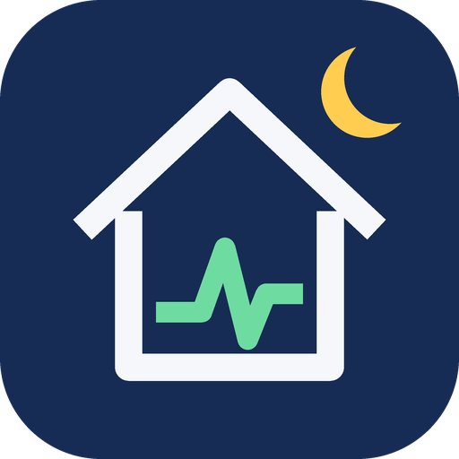

<p align="center">
  
</p>

# Base Load Monitor

[](https://hacs.xyz/docs/faq/custom_repositories/)
[](https://github.com/markdoel/ha-base-load/actions/workflows/ci.yml)
[](https://github.com/markdoel/ha-base-load/releases)
[](LICENSE)

Custom integration for Home Assistant that learns the normal night-time base load
of a household from long-term statistics and reports unusual deviations, in both
directions:

- **high**: something keeps running that normally does not (a forgotten heater, a stuck inverter, a pump)
- **low**: something that should run has stopped (fridge, freezer, network gear)

No extra data storage and no learning phase: the baseline is computed directly from
the recorder's hourly statistics, so years of existing data are usable on day one.

## How it works

```
house load = grid import + local sources (PV, battery) - excluded loads
```

1. Hourly mean, min and max of all selected sensors are read from the recorder for
   the learning period (default 8 weeks).
2. Excluded loads (e.g. the EV charger) are subtracted when they ran the whole hour
   or not at all. Hours in which they switched on or off are dropped, because sensor
   lag makes the subtraction unreliable at the edges. Charging nights stay usable.
3. Gaps in local sources are bridged with the last value if that value was small
   (up to 50 W) and recent (up to 12 hours). Battery hubs often stop reporting at
   night while idle. Any other gap drops the hour, so a battery delivering power
   without data never looks like extra consumption.
4. Hours inside the night window (default 01:00 to 05:00) are grouped into workday
   and weekend nights. The day type is that of the morning after.
5. Per day type a weighted **median** and **MAD** are computed. Both are robust
   against outliers. Recent nights weigh more (half life 14 days by default), so the
   baseline follows lasting changes like the start of the heating season within
   about two weeks instead of a month.
6. During the night the median of the last hour (5-minute statistics) is compared
   with the baseline. For the last completed night the median of its hours is used.
   A single appliance run, like a dishwasher started at midnight, therefore does not
   count as base load, a load that lasts most of the night does. An anomaly needs both a robust score above the sensitivity and
   an absolute deviation above the minimum.

The night being evaluated never enters its own baseline.

## Cause analysis

When the base load deviates, the integration suggests what caused it:

1. **Measured devices.** Select plugs or sub-meters under *Devices for cause analysis*.
   Each one gets its own night baseline, learned on the same hours as the house.
   Devices that moved in the same direction as the total and stand out from their
   own spread are ranked by size, for example `Heater +300 W`.
2. **The rest.** Whatever the selected devices do not explain is reported as
   unmeasured, together with its onset and shape, for example
   `Unmeasured +240 W (constant since 23:40)`. A constant step usually means a single
   device left running (heater, lamp, pump), an intermittent one a device that cycles
   (fridge, dehumidifier, heating rod).

The analysis runs for clear deviations (at least the minimum deviation), even when
the score stays below the anomaly threshold.

Do not select a group sensor together with its members, the deviation would be
counted twice.

## Breakdown and level shifts

- **Unmeasured base load** shows how much of the weekly base load no selected
  device explains. Its `devices` attribute ranks the selected devices by their own
  night load, with share and cost per year: the list to start saving with.
- **New base load level** detects lasting changes. If the last three nights of the
  house or a device all sit clearly off the level of nights older than ten days, it
  reports the change and the night it started, e.g. `Heizung +77 W since 02.11.`.
  Each new shift also fires the event `base_load_level_shift` once.

## Morning notification and feedback

Set a notify service (e.g. `notify.mobile_app_pixel`) and a time. After an unusual
night, or when a new level shift appears, a message is sent with the probable cause
and the yearly cost. Mobile app notifications get two buttons:

- **Normal**: the night is confirmed and no longer reported.
- **Name it**: type what it was, e.g. `Dishwasher`. The unexplained pattern of that
  night (size, start time, duration, constant or intermittent) is stored under the
  name. Similar patterns are later reported with that name instead of "unmeasured".

The same is available as services `base_load.mark_normal` and `base_load.label_night`.

## Presence and holidays

Select a presence entity to skip nights in which nobody was home:

| Entity | Away when |
|---|---|
| `zone.home` | 0 persons in the zone |
| `person.*`, `group.*`, `device_tracker.*` | state is not `home` |
| `input_boolean.*`, `binary_sensor.*` | `on` (a holiday switch) |

A night counts as away if nobody was home for at least half of the window. Away
nights are not evaluated (status `away`) and never enter the baseline. Presence is
read back from the recorder about 10 days and remembered after that.

## Cost

Select a price entity (sensor or input number, `EUR/kWh`, `ct/kWh` or similar) to get:

- **Base load cost per year**: the weekly average of the baseline, running all year.
- **Deviation cost per year**: what last night's extra load would cost if it stayed,
  plus the cost of last night itself as an attribute.

Dynamic prices (Tibber, aWATTar, ...) are averaged over the last 30 days from the
long-term statistics. Entities without statistics use their current value.

## Reliability

- **Renamed entities are followed.** Renaming a configured sensor updates the settings.
- **Removed entities raise a repair** under *Settings → System → Repairs*.
- **Data quality** (diagnostic sensor) is the share of valid night hours in the
  learning period. **Data incomplete** (diagnostic binary sensor) turns on if the
  quality drops below 50 %, the last night had less than half its hours, or updates
  fail. A night without enough data is never reported as normal.
- **Short outages are bridged.** Up to six failed updates in a row keep the last
  result (marked stale). The baseline is stored and survives restarts.

## Entities

| Entity | Description |
|---|---|
| `sensor.<name>_expected_base_load` | Baseline median for the current day type, attributes for both day types |
| `sensor.<name>_current_base_load` | House load, median of the last hour |
| `sensor.<name>_base_load_deviation` | Deviation from the baseline during the night window, with `score` and `direction` |
| `sensor.<name>_last_night_base_load` | Median house load of the last completed night |
| `sensor.<name>_probable_cause` | Suggested cause for the running night, attributes `causes`, `unexplained`, `pattern`, `onset` |
| `sensor.<name>_last_night_probable_cause` | Suggested cause for the last completed night |
| `binary_sensor.<name>_base_load_anomaly` | On while the current night deviates. Attribute `status`: `monitoring`, `learning`, `outside_night_window`, `excluded_load_active`, `no_data` |
| `binary_sensor.<name>_last_night_anomaly` | Verdict for the last completed night, ideal for a morning notification. Attribute `status`: `evaluated`, `away`, `no_data`, `learning` |
| `sensor.<name>_base_load_cost_per_year` | Only with a price entity |
| `sensor.<name>_deviation_cost_per_year` | Only with a price entity |
| `sensor.<name>_unmeasured_base_load` | Base load not explained by selected devices, attribute `devices` with power, share and cost |
| `sensor.<name>_new_base_load_level` | Lasting level shifts, attribute `shifts` |
| `sensor.<name>_data_quality` | Diagnostic, share of valid night hours |
| `binary_sensor.<name>_data_incomplete` | Diagnostic, attribute `reasons` |

## Requirements

- All selected sensors need `state_class: measurement` and `device_class: power`,
  otherwise the recorder keeps no long-term statistics for them.
- The grid sensor may be negative during export.

## Installation

### HACS (recommended)

[](https://my.home-assistant.io/redirect/hacs_repository/?owner=markdoel&repository=ha-base-load&category=integration)

1. In HACS, open the menu and choose *Custom repositories*.
2. Add `https://github.com/markdoel/ha-base-load` with category *Integration*.
3. Install **Base Load Monitor** and restart Home Assistant.
4. Add the integration under *Settings → Devices & services*.

### Manual

Copy `custom_components/base_load` into your `config/custom_components` folder and
restart Home Assistant.

## Configuration example

| Field | Example |
|---|---|
| Grid power sensor | Smart meter reader (Tibber Pulse, Shelly 3EM, ...) |
| Local sources | Battery or PV inverter output |
| Loads to exclude | EV charger, heat pump |
| Night window | 1 to 5 |

All settings can be changed later via *Configure* on the integration.

## Example automation: morning notification

```yaml
triggers:
  - trigger: time
    at: "06:30:00"
conditions:
  - condition: state
    entity_id: binary_sensor.base_load_last_night_anomaly
    state: "on"
actions:
  - action: notify.notify
    data:
      title: Unusual night load
      message: >
        Last night the base load was
        {{ state_attr('binary_sensor.base_load_last_night_anomaly', 'deviation') }} W
        off the usual level. Probable cause:
        {{ states('sensor.base_load_last_night_probable_cause') }}
```

## Dashboard

`dashboards/base_load.yaml` contains a ready-made view. Open a dashboard, choose
*Edit → Raw configuration editor*, paste the view under `views:` and replace
`base_load` in the entity IDs with the name of your entry if needed.

## Diagnostics

*Settings → Devices & services → Base Load Monitor → Download diagnostics* returns
the configuration, the baseline and the latest evaluation. It contains no secrets.

## Releases

Bump `version` in `custom_components/base_load/manifest.json` and push to `main`.
The release workflow runs the tests and publishes tag and release `v<version>`.

## Development

```bash
pip install -r requirements_test.txt
pytest
ruff check custom_components tests
```

## License

MIT
